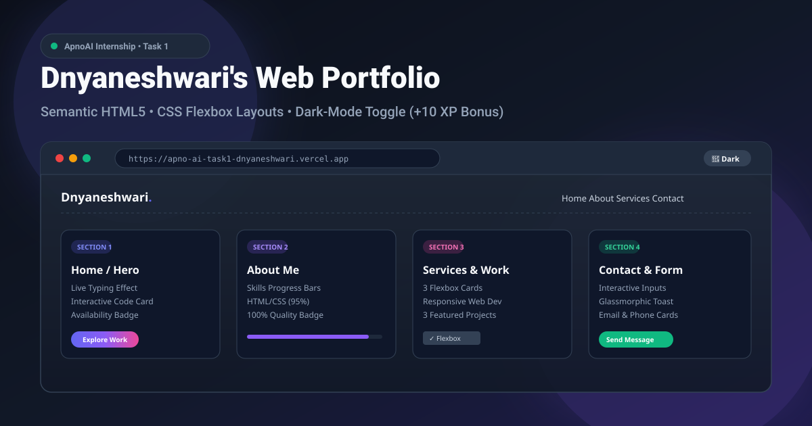

# 🚀 ApnoAI Internship - Task 1: Ship Your First Web Page

<div align="center">



[](https://github.com/D-23Git/Apno-Ai_Task1)
[-10b981?style=for-the-badge&logo=checkmarx&logoColor=white)](https://github.com/D-23Git/Apno-Ai_Task1)
[](https://github.com/D-23Git/Apno-Ai_Task1)
[](https://github.com/D-23Git/Apno-Ai_Task1)
[](https://vercel.com)

**A modern, responsive, 4-section portfolio website built with clean semantic HTML5, CSS Flexbox layouts, interactive widgets, and an instant Dark/Light mode switcher.**

[🌐 Live Website](https://apno-aitask1.vercel.app/) • [📂 GitHub Repository](https://github.com/D-23Git/Apno-Ai_Task1) • [📝 Submission Guide](#-task-submission-details)

</div>

---

## 📌 Project Overview

This repository contains the completed **Task 1: Ship Your First Web Page** for the **ApnoAI Web Development Internship**. The website is designed to highlight developer skills, featured projects, and services through a sleek, modern visual aesthetic.

### 🎯 Key Evaluation Rubric & Status
| Requirement | Specification | Status |
| :--- | :--- | :---: |
| **HTML Page Structure** | Semantic HTML5 tags (`<header>`, `<nav>`, `<main>`, `<section>`, `<footer>`) | ✅ 100% |
| **4 Core Sections** | Home, About, Services (3 cards), Contact | ✅ 100% |
| **CSS Layout** | Built with CSS Flexbox & custom design variables | ✅ 100% |
| **Mobile Responsiveness** | Fluid media queries (`max-width: 768px`) & hamburger menu | ✅ 100% |
| **Deployment** | Version controlled on GitHub & hosted on Vercel | ✅ 100% |
| **🌟 Bonus (+10 XP)** | Functional Dark/Light mode toggle with `localStorage` memory | ✅ **+10 XP** |

---

## 🏛️ Website Architecture (4 Core Sections)

```
├── 1. Home (Hero Section)        --> Dynamic typing text, developer code visual, CTA buttons
├── 2. About Me Section           --> Bio, 100% dedication badge, animated skills progress bars
├── 3. Services & Work Section    --> 3 Flexbox service cards + 3 Featured Project showcases
└── 4. Contact Section            --> Info cards (Email, Phone, Location) + Glassmorphic Toast form
```

### 1. Home (Hero Section)
- **Live Typewriter Effect:** Cycles dynamically between *"Modern Web Experiences"*, *"Responsive Interfaces"*, *"Creative UI/UX Designs"*, and *"Fast & Accessible Websites"*.
- **Pulsing Availability Badge:** Indicates real-time readiness for internships and development projects.
- **Interactive Code Visual (`developer.profile`):** A custom syntax-highlighted code card illustrating technical focus.

### 2. About Me Section
- **Personal Bio & Quality Badge:** Details design principles, pixel-perfection, and code performance.
- **Animated Skills Progress Bars:** Visual metrics representing proficiency in HTML5 (95%), CSS3/Flexbox (92%), UI/UX Theming (90%), and Deployment (88%).

### 3. Services Section (3 Core Flexbox Cards)
- **Card 1: Responsive Web Development** — Fluid multi-device compatibility using semantic HTML5 and Flexbox.
- **Card 2: Modern UI/UX Styling** — Soft cards, glassmorphic blur, micro-animations, and instant theme toggling.
- **Card 3: Web Deployment & Hosting** — Git version control and zero-config live deployments on Vercel.
- **⭐ Bonus Showcase: Featured Projects:** Includes project mockups for *ApnoAI Developer Portfolio*, *Smart Weather & Task Hub*, and *SaaS Product Landing Page*.

### 4. Contact Section
- **Direct Info Cards:** Quick links for Email, Phone number, and Location.
- **Interactive Form with Custom Toast:** Modern popup notification confirming message delivery without obstructive browser dialogs.

---

## 🌓 Dark Mode Toggle (+10 XP Bonus)

The website includes a floating navigation toggle switch with **Sun ☀️ and Moon 🌙 SVG icons**:
- **Light Theme:** Fresh, clean slate background with vibrant indigo and purple gradients.
- **Dark Theme:** Deep obsidian navy (`#0b0f19`) with soft glowing cards and high-contrast typography.
- **Memory Retention:** Automatically saves user preference using browser `localStorage`.

---

## 💻 How to Run Locally

1. **Clone or Download the Repository:**
   ```bash
   git clone https://github.com/D-23Git/Apno-Ai_Task1.git
   ```
2. **Open the Project:**
   - Double-click `index.html` to open it directly in any modern browser (Chrome, Edge, Firefox, Safari).
   - Alternatively, open the folder in **VS Code** and run with the *Live Server* extension.

---

## 🚀 Deployment on Vercel

1. Log in to [vercel.com](https://vercel.com) using your GitHub account.
2. Click **Add New... ➔ Project**.
3. Select `Apno-Ai_Task1` from the GitHub repository list.
4. Keep the default settings and click **Deploy**.
5. Your live URL is generated instantly!

---

## 📋 Task Submission Details

- **Author:** Dnyaneshwari
- **Task:** ApnoAI Internship Task 1 — *Ship Your First Web Page*
- **Submission Note (How I used AI):**
  > *"I used AI assistance to architect a responsive HTML5 & CSS Flexbox layout, craft custom UI micro-interactions, and build a persistent dark-mode switcher for the +10 XP bonus."*

---

<div align="center">
  <sub>Built with ❤️ by Dnyaneshwari for the ApnoAI Internship Program.</sub>
</div>
